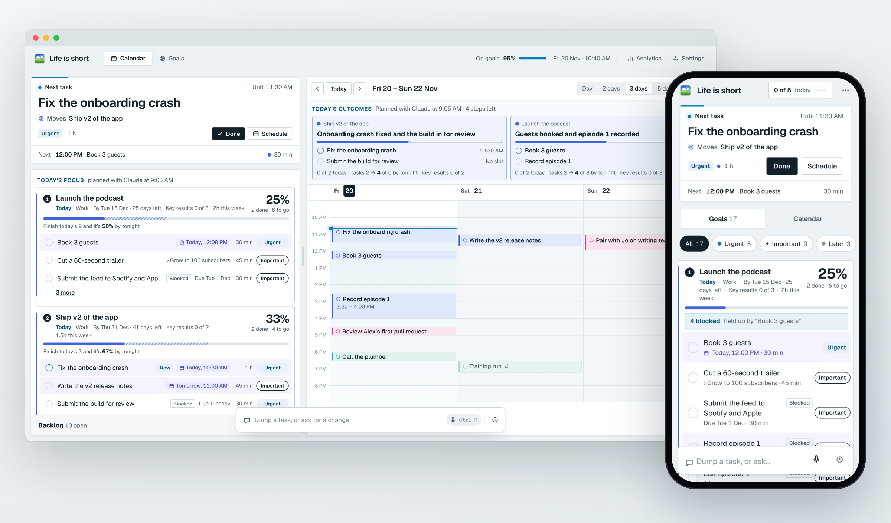
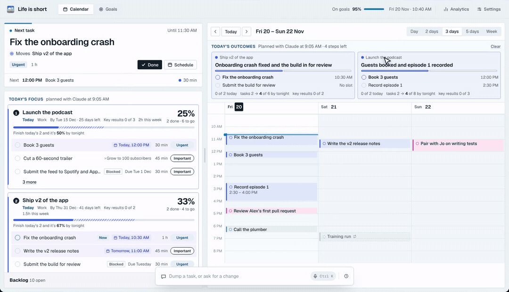
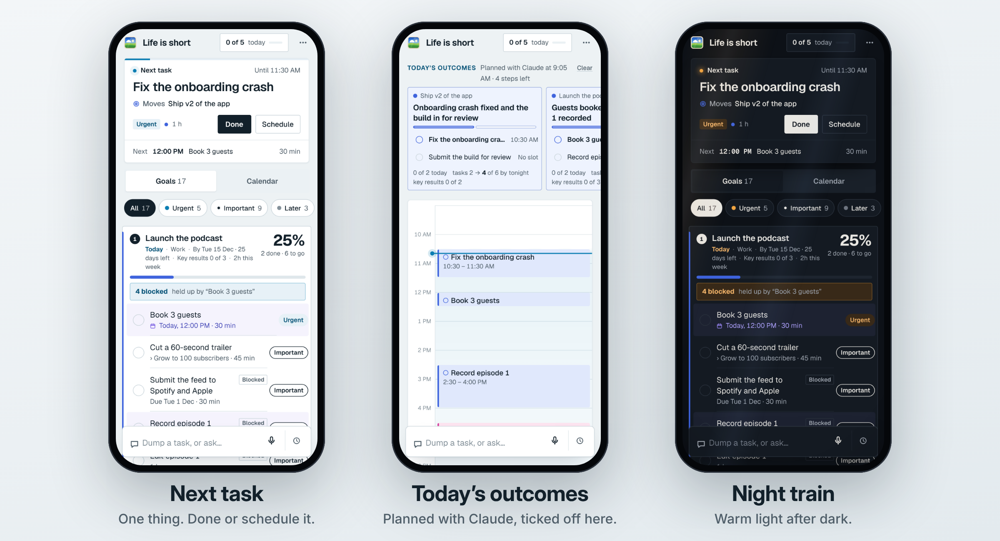
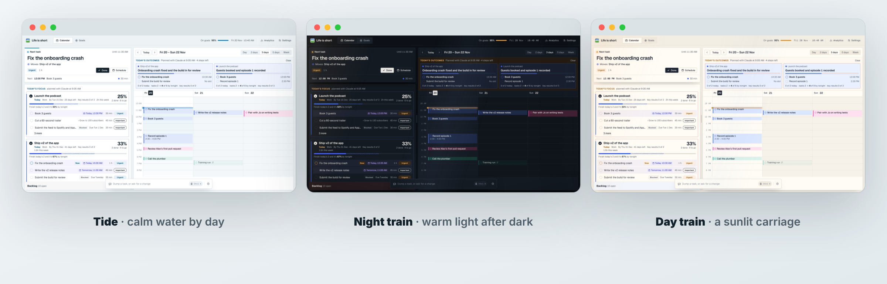
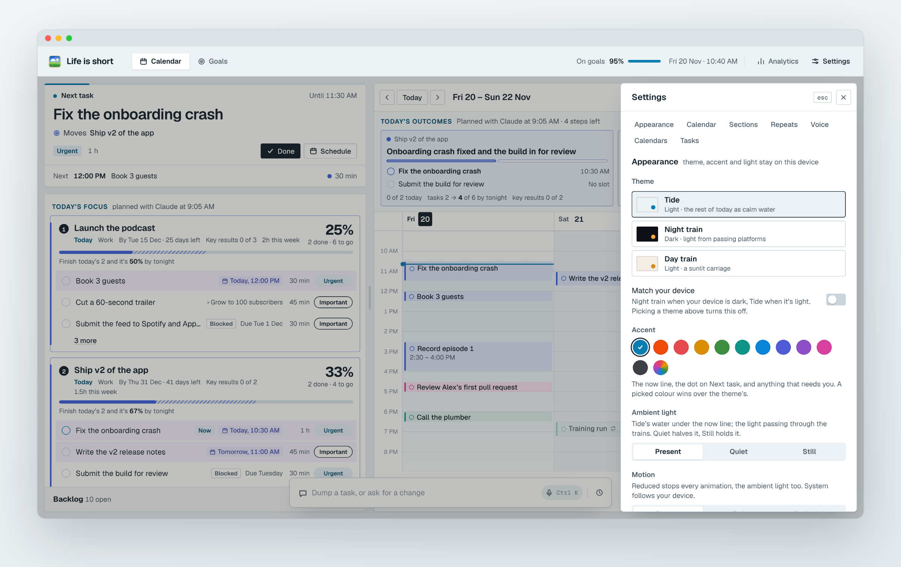
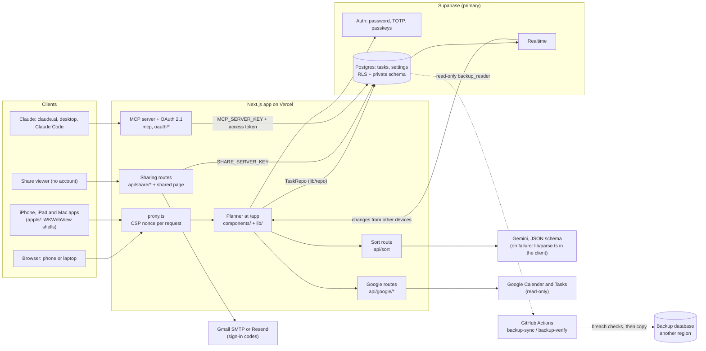

<p align="center"></p>

<p align="center">
  <a href="https://github.com/abhinav-adtechs/life-is-short/actions/workflows/ci.yml"></a>
  <a href="https://life-is-short-pi.vercel.app"></a>
  
  
  <a href="LICENSE"></a>
  <a href="https://github.com/abhinav-adtechs/life-is-short/commits/main"></a>
  <a href="https://github.com/abhinav-adtechs/life-is-short/stargazers"></a>
</p>

<p align="center"><b>Say what's on your mind. Life is short turns it into tasks, puts them on your calendar,<br>and shows you the one thing to do right now.</b></p>

<p align="center">
  <a href="#features">Features</a> ·
  <a href="#quick-start">Quick start</a> ·
  <a href="#architecture">Architecture</a> ·
  <a href="#docs">Docs</a> ·
  <a href="#roadmap">Roadmap</a> ·
  <a href="#contributing">Contributing</a>
</p>
[Goals](#goals-first) · [How it works](#how-it-works) · [Repeats](#things-that-come-back) · [Review](#see-how-it-went) · [Design](#designed-to-get-out-of-the-way) · [Make it yours](#make-it-yours) · [Sharing](#share-a-view-keep-the-keys) · [Claude](#connect-claude) · [Security](#locked-down-by-default) · [Run your own](#run-your-own)

<br>

<picture>
  <source media="(prefers-color-scheme: dark)" srcset="docs/images/hero-dark.png">
  
</picture>

<br>

## Why Life is short?

**Stop managing your to-do list.**

You get about four thousand weeks. That's it. And most to-do apps want you to spend them _organising_: projects, tags, inboxes, contexts, reviews, a list that only gets longer.

**Life is short does the opposite.** One box to dump things into. One answer on the screen.

> **Dump it.** Type it or say it. A word, a list or a thirty-second ramble. You see the plan before anything changes.
>
> **Slot it.** A day or a time puts it on your calendar. Anything else lands in a backlog, already prioritised.
>
> **Do it.** The screen shows the one thing to do now, a **Done** button and a **Schedule** button. Nothing else to manage.

No folders. No filing: the AI even picks the goal. No "weekly review". You don't keep a system going; you get on with your day.

<br>

## Goals first

A list of tasks says what's busy. It doesn't say what matters. So Life is short starts from **four or five goals**: the outcomes you're working towards right now, like an objective with its key results.

- **Specific enough to finish.** "Give Sam a clean exit", not "Fundraising". Each goal says what **done** means (*Share transfer signed*, *Money in the bank*), lines you tick as they come true, and, if you like, a date to get it done by.
- **In a section.** Goals sit in the parts of your life you name: your company, a side project, Personal, Helping others. A task on a goal takes its section and its colour.
- **Ranked.** Your top goal first. The order breaks ties in the backlog.
- **Broken down, OKR style.** A goal can have **sub-goals**, and they can have their own, a few levels down. A sub-goal can serve the goal as a whole or one of its **key results**, and key results can have key results under them. Type them as an indented outline (Tab indents a line under the one above), or add them in place with **+ Key result** and **+ Sub-goal**. A key result is done once everything under it is, and each goal shows how far along it is, counting its key results and the sub-goals that serve them. The main page keeps one card per top goal: a sub-goal's tasks sit in its top goal's card, in its section, and its time counts towards it. Closing a goal closes what's under it; bringing a sub-goal back brings back the goals above it.
- **Every task moves a goal, or it's off-goal.** The AI puts each thing you dump on the goal it moves, strictly: loosely related doesn't count. Errands, admin and favours land **off-goal**, which is fine, as long as you know. Change it on any task, drag it to another goal's row, or type a `#tag` naming the goal.
- **Time on goals, all week.** Tick something off, or sit through a meeting that's on a goal, and the time counts towards it. The header says what share of your week went to goals; **Goals** shows each one's time, what's planned, what's open and what's ticked; the review breaks it down by day, week or month and says which goal got nothing.
- **Achieved, dropped, brought back.** Closing a goal moves its open tasks off-goal; the time you spent on it stays in your reviews.

**Urgent and Important still count**, with goals telling you *what matters* and priority telling you *when*. The main page is **a card per goal**, most important first. Each card leads with **how much of its work is done**, big (*30% · 3 done, 7 to go*), then its deadline, key results and time this week. **What's blocked is called out** with what's holding it up (*2 blocked, held up by waiting on "Buyer's funds"*), one click from the chart. Then its tasks, **on the calendar or not**, in the order to do them: what can start now before what's blocked, then urgent first, nearest deadline, soonest on the calendar. It shows five, then **View more**; the flow chart has everything. A task on the calendar is **in its own colour** with its time, and a missed one comes back to its goal's card an hour after its slot. An **Off-goal** card comes last. Each task wears its priority as a pill (click it to change it: **Urgent → Important → Later**), and a row of chips shows one priority across every goal. Drag a task onto another goal's card to move it there, or onto a priority chip to change its priority. At the same priority, work on a goal comes before off-goal work, then deadlines, then your goals' order, so the **Next task** is whatever moves your goals soonest. It says which goal it moves.

### Every goal as a flow chart

Open **Goals → Flow chart** (or click "Moves ‹goal›" on the Next task) and the goal is laid out as a precedence diagram, the way project plans draw dependencies:

- **Left to right.** The goal sits on the left. Each step goes one column after the steps it needs, so the chart lays itself out and stays readable as it grows. Arrows that skip columns get a lane of their own, so they never run behind a step.
- **An arrow means "finish this first"** (finish-to-start). Steps with no arrow between them are **parallel**.
- **Standard shapes.** The goal is a *terminator* (pill), tasks are *process* boxes, **Waiting on** steps (a reply, a signature, someone else's work) use the D-shaped *delay*, sub-goals are *predefined process* boxes with doubled sides, and the goal's "Done when" lines are pointed **milestones** on the right.
- **The goal's structure, drawn for you.** A key result under another leads to it, and a sub-goal leads to the key result it serves, as dotted arrows you don't have to draw. A sub-goal is one step, as long as the open work on it and under it, with its progress; a step after it waits until it's achieved. Double-click it to open its own chart; a trail at the top takes you back up.
- **Live.** Every task on the goal is a step, so the chart is always current: **Done**, **Ready** or **Blocked**, with the **critical path** (the chain with the most work left) in your accent colour. A blocked task never comes up as your **Next task** and wears a *Blocked* tag on the main page.
- **An editor that keeps up with you.**
  - **Drag a step anywhere**; it stays where you put it (on a phone, hold it first). **Tidy up** lays the chart out again.
  - **Bring in the backlog**: the side panel lists your off-goal tasks. Drag one onto the chart to put it on this goal, onto a step to follow it or anywhere, or press its **+** to add it after the selected step. The list stays open for the next one.
  - **Scheduled steps** are in the calendar's colour, with their time; the key at the bottom says which is which.
  - **Add in one click**: the palette beside the chart has a **Step**, **Waiting on**, **Sub-goal** and **Key result**. Click one to add it next to the selected step, or drag it onto the chart: onto a step to go with it, or onto an empty spot to put it there. Each step also has a **+** for the next step and one for a parallel step, and double-clicking an empty spot adds a step there.
  - **Draw arrows** by dragging from a step's dot to the step after it, or by clicking the dot and then the step. Loops are refused.
  - **Keys**: **Tab** adds the next step and **Enter** a parallel one, and you type the title straight away. Arrow keys move to the nearest step that way. **Delete** removes the selected arrow, or asks before deleting the selected step (Delete or Enter again to confirm, Esc to keep it). **⌘Z** undoes.
  - The side panel edits a step: its title, length and priority, what it needs first and what it unblocks, and something to wait on.
- **History.** Every step added, linked, finished, renamed or resolved is logged, so you can see how the plan changed. Download it, or the chart itself as **JSON** or as a **Mermaid** flowchart for GitHub, Notion or any docs tool. Claude's `list_goals` returns each goal's chart too.

The arrows and waiting steps are kept on the goal in your synced settings; the history under `goal-log`. Nothing new to migrate.

## Features

<table>
<tr>
<td width="50%" valign="top">

### 🎙️ Dump it

Type or talk (`⌘K`). The AI pulls out every task with a title, priority, length and date, spots what's **already on your list**, and shows you the plan before anything lands. [How it works ↓](#how-it-works)

</td>
<td width="50%" valign="top">

### 🗓️ Slot it

A day or time goes on the calendar; a deadline waits in the backlog with a due date; anything else is ranked **Urgent**, **Important**, **Later**. One tap finds the next free gap on a 15-minute grid.

</td>
</tr>
<tr>
<td valign="top">

### ✅ Do it

The top of the screen is always the **Next task**, with **Done** and **Schedule**. Missed one? It stays an hour, then goes back on top of the backlog. No guilt, no lost tasks.

</td>
<td valign="top">

### 🔁 Things that come back

_"Order groceries every Monday and Thursday."_ Say it once and it repeats, one at a time, on its day and not before. [Repeats ↓](#things-that-come-back)

</td>
</tr>
<tr>
<td valign="top">

### 📊 See how it went

A score out of 100 for a day, week or month, worked out from every task: done and missed, time by label, rhythm, flow and load. [Review ↓](#see-how-it-went)

</td>
<td valign="top">

### 🎨 Make it yours

Three themes (**Tide**, **Night train**, **Day train**), ambient light, 10 accents, 9 fonts including Lexend and Atkinson Hyperlegible, increased contrast and reduced motion. [Themes ↓](#make-it-yours)

</td>
</tr>
<tr>
<td valign="top">

### 📆 One calendar for your whole life

Up to **five Google accounts**: Calendar events and Google Tasks on one calendar, each in its own colour. Read-only, nothing written back. [Google ↓](#your-whole-life-one-calendar)

</td>
<td valign="top">

### 📱 On every screen you own

Live sync between phone and laptop in seconds, plus **iPhone, iPad and Mac apps** with on-device dictation, Siri and Shortcuts. [Apps ↓](#on-every-screen-you-own)

</td>
</tr>
<tr>
<td valign="top">

### 👀 Share a view, keep the keys

A view-only window into your planner: you pick what they see and until when; they sign in with a code sent to their email. [Sharing ↓](#share-a-view-keep-the-keys)

</td>
<td valign="top">

### 🤖 Connect Claude

A built-in **MCP server** at `/mcp` with OAuth 2.1, so Claude can read and change your tasks as a custom connector. [Claude ↓](#connect-claude)

</td>
</tr>
<tr>
<td valign="top">

### 🔐 Locked down by default

PIN + authenticator code, PIN + Face ID, or a passkey. Row-level security in the database, a strict CSP, and a nightly breach-checked backup. [Security ↓](#locked-down-by-default)

</td>
<td valign="top">

### 🪶 Works with no keys at all

No AI key? A built-in parser understands "tomorrow at 9", "by Friday", "urgent", "2h" and "someday". No Supabase? It runs **entirely in your browser**.

</td>
</tr>
</table>

## How it works

<p align="center">
  
</p>

<table>
<tr>
<td width="33%" valign="top">

### 1 · Dump

Type in the chat bar or tap the mic (or press `⌘K`, `Ctrl K` on Windows) and **just talk**. Your words stream in as you speak, and it keeps listening until you tap stop or press `⌘K` again; `Esc` throws it away with an Undo.

_"Finished the roadmap draft. Call the plumber tomorrow at 9, landing page copy is due Friday, and book a haircut at some point."_

The AI reads it like a good assistant would. It pulls out every task, gives each a short title, a priority and a realistic length, and works out dates. It also spots when you're talking about something **already on your list**: "finished the roadmap" ticks it off instead of adding a duplicate.

**Nothing lands until you say so.** When you stop talking you get the full transcript and the plan, one row per change: _add_, _move_, _tick off_. On a laptop the plan shows on the calendar too, dashed, right where it would go. Tap a change to edit it, untick one you don't want, or just keep talking ("make the haircut Thursday afternoon") and the plan updates. **Apply** and it's done, with Undo; the chat clears for next time and lands in your history.

</td>
<td width="33%" valign="top">

### 2 · Slot

- **Said a day or a time?** It goes straight onto the calendar.
- **Said a deadline?** It waits in the backlog with a due date.
- **Said neither?** It waits in the backlog, ranked: **Urgent**, **Important**, **Later**, then by due date.
- **Every task gets a goal or goes off-goal**, and a section, like your company, **Personal** or **Helping others**. The AI picks both from what you said, or type a `#tag`.

When you're ready, one tap finds the **next free gap in your day**, on a 15-minute grid, inside the hours you set.

</td>
<td width="33%" valign="top">

### 3 · Do

The top of the screen is always the **Next task**: the task on your calendar at this minute, or the most important thing in your backlog, with how long you have for it.

**Done.** Or **Schedule**: click a time, or take the next free slot. Below it you see what comes **Next**.

Slipped past something? When its slot ends without a tick, it stays on your calendar for an hour, in case you did it and just haven't ticked it off. Then it goes **back on top of your backlog**, ready for another go. No guilt, no lost tasks.

</td>
</tr>
</table>

**It learns how you talk.** The AI knows you spoke, so it reads past misheard words, fillers and "at 3, no, 4" and shows what it took you to mean (what the mic heard is a tap away). Mic got a word wrong? **Fix what I said** and it asks again. Every chat you apply teaches it: your names and places, what the mic mishears ("plum bar" is _plumber_), and how you put things ("kal" means tomorrow). The mic listens out for your words from then on, and a mishearing it's sure of is fixed while you're still talking. Pick the mic's language (English (India), say) and see or change everything it learned in **Settings → Voice**.

Every capture, move and tick comes with **Undo**. A half-typed thought is still there when you come back. No AI key? A built-in parser understands "tomorrow at 9", "by Friday", "urgent", "2h" and "someday", so it keeps working.

## A closer look

### Things that come back

_"Order groceries every Monday and Thursday."_ _"Gym Mon, Wed and Fri at 7am."_ _"Pay rent on the 1st of every month."_

Say it once and it's a **repeat**: every day, on weekdays, on the days you name, every other week, every few days or once a month. The AI hears it, and so does the built-in parser. Or open any task and pick **Repeat**.

- **On its day, not before.** Each day it lands on, you get one ordinary task. With a time it goes on the calendar; without one it waits in the backlog, due that day. Thursday's grocery order is never Tuesday's Next task.
- **One at a time.** Skip Monday's order and Thursday's takes its place, so you never have two "Order groceries". The one you skipped still counts as missed in the review.
- **Ahead on the calendar.** Repeats with a time show faintly on the days to come, and slotting works around them.
- **Change the task, change the repeat.** Rename it, re-prioritise it or put it on a goal, and the ones to come follow. Moving one on the calendar moves just that one.
- **Skip one or stop them all.** Delete today's to skip it; it won't come back. Pick *Doesn't repeat*, say *"stop the grocery repeat"*, or use **Settings → Repeats**, which lists everything that repeats and when it comes next.

### See how it went

Open **Analytics** (at the top on a laptop, in the `•••` menu on a phone) for how the week is going, then **Full review** for how a **day, week or month** went, worked out from everything on your list. Step back through earlier ones with the arrows (or ← and →).

- **A score out of 100**, and what it's made of: how much of what came due got done, how much on its day, how many of your busy days you got something done, and how your Urgent and Important work fared. Under it, what stood out, in plain sentences.
- **Done and missed.** Every task with a slot or a deadline is on time, late, missed or still to come. A missed task goes back to your backlog, but its slot still counts as missed where it happened, and so does one you reslot or delete, so the review stays honest.
- **Goals.** Time on each goal and off-goal, your tasks and your Google meetings together, with each one's share, what got done and what was missed. It says what share of your time went to goals, against the stretch before.
- **Type of work.** The same by section.
- **Day by day, hour by hour.** Stacked by section, with missed slots marked. Pick a day to open it. Every chart has a table view.
- **Rhythm, flow and load.** The hour you get the most done, what came in against what went out, how long things take from capture to done, how full your calendar was against your day, and quick wins against deep work.
- **The trend and the tasks behind it.** The last 14 days, 8 weeks or 6 months side by side, and every task that was missed, late, done or still to come.

A week still under way is held up against last week up to the same point, so a Tuesday isn't measured against a whole week.

### Designed to get out of the way

There are only two heavy things on any screen: **the task you're on, and the mic.** Everything else stays quiet.

Pick a light to plan by. **Tide** is cool and bright: a slow wave runs under the current time, and a hairline across the Next task fills as your day goes. **Night train** is warm amber on deep blue, with the light of a passing platform sweeping across now and then and a lamp glowing by the task you're on. **Day train** is the same carriage by daylight. Prefer stillness? Turn the ambient light down to Quiet or Still.

<p align="center">
  
</p>

**On your phone** it's focused: the Next task on top with Done and Schedule, then your goal cards or your calendar a tab away, and the chat bar under your thumb. Tap Schedule, then tap a time; the timeline marks the next free slot for you. Press and hold a task to drag it onto **Done** or the **trash**. How the day and week are going, how much went to goals, Goals, Analytics, Share and Settings are in the `•••` menu.

**On your laptop** it opens up into a full planner: the Next task and your goal cards on the left, a calendar that fits your day on the right, and the chat bar floating over it.

- **Your goals are your backlog:** a card per goal and one for off-goal, each with its progress, deadline, time this week and next few tasks, **+ Task** to add one in place and **Flow chart** to plan it out. The **All · Urgent · Important · Later** chips show one priority across every goal. Drag a task onto another card to change its goal, or onto a chip to change its priority.
- **One divider, sized your way.** Drag it and the calendar shows 1, 2, 3, 5 or 7 days, settling on the nearest. Arrow keys step it, a double-click resets it. Give the goals the room and their cards sit side by side.
- **The calendar fits your day:** your hours fill the height, with one tap for anything earlier or later, and a live wave (or line) at the current time.
- **Drag** a task from its goal's card onto any time. Drag it back to unschedule it.
- **Drop it on Done or the trash.** While you drag a task, two targets rise where the chat bar sits: **Done** ticks it off, the **trash** deletes it. Both come with Undo.
- **Drag the edge** of a block to make it longer or shorter.
- **Click, then click.** Pick a task, then click a time slot, or take the next free one.
- **The chat bar** (`⌘K` to speak, `⇧⌘K` to type) grows into a panel: the plan comes back as a list of changes to tick on or off before you apply them, and History keeps every past chat with its Undo.
- **Analytics, Share and Settings** slide in from the side, so the planner stays in view.
- **Keyboard-friendly:** `E` edits, `Enter` opens a block, `Delete` sends it back to the backlog, `Esc` closes anything.

</details>

It feels fast because it is fast: rows rise in, ticked tasks get a check-and-strike, the next task's time flips in, and your theme loads before the first frame, so it never flashes. Reduced motion keeps all of it still.

### Make it yours

<p align="center">
  
</p>

- **3 themes:** Tide, Night train and Day train, or match your device (Night train after dark, Tide by day).
- **Ambient light:** Present, Quiet or Still. Reduced motion holds it still too.
- **10 accent colours**, each theme's own, or pick your own. Life is short adjusts it until it's readable on your background.
- **9 fonts**, including **Lexend** and **Atkinson Hyperlegible** for easier reading.
- Text size, list density, **increased contrast**, reduced motion, and a 12- or 24-hour clock.
- **Your day:** set the hours you work. The calendar shows them, auto-slotting stays inside them, and the AI plans around them.
- **Your sections:** the parts of your life your goals live in, named, coloured and ordered your way. Every task wears its section's colour, so work time and personal time read at a glance.
- Week starts Monday, Sunday or Saturday. Shade weekends, show ISO week numbers, colour events by section, account, calendar or priority.

<p align="center">
  
</p>

Every change previews live and **follows you to your other devices**. The theme, accent and ambient light stay per device, so your phone can follow the sun while your laptop rides the night train.

### Your whole life, one calendar

Connect **up to five Google accounts**, personal and work alike. Their **Google Calendar events and Google Tasks** land on the same calendar, each account in its own colour, so Life is short slots your tasks around the meetings you already have.

- It refreshes every 30 minutes while the app is open.
- A meeting that's on two of your accounts shows **once**.
- You choose which calendars to pull, per account. Holidays and other subscriptions stay off until you tick them.
- Give each account a **section** (or one calendar inside it, like a gym calendar on your work account) and its events take that section's colour. Put a meeting on a goal and its time counts towards it.
- It's **read-only**: nothing is written back to Google. Your priorities, notes and done ticks stay yours.

### On every screen you own

Add a task on your phone in the queue for coffee and it's **on your laptop within seconds**. Live sync keeps every open screen up to date, and the phone and the laptop each get a layout built for them.

**Apps for iPhone, iPad and Mac** wrap the same planner in a native window: dictation on the device, Siri and Shortcuts ("Dump a thought in Life is short"), Home Screen quick actions, and a Mac menu bar with every shortcut. They update whenever the planner does, and ship through TestFlight. See [`docs/apple.md`](docs/apple.md).

[](https://github.com/abhinav-adtechs/life-is-short/actions/workflows/apple.yml)

Want to try it without an account? Run it with no keys and it works **entirely in your browser**.

### Share a view, keep the keys

Let someone see your planner without handing it over. **Settings → Sharing**: add their email, pick what they see and for how long, and send them the link.

- **What they see is up to you:** the backlog, the calendar (today, upcoming or all), titles or just _busy_, with or without your Google events. Never your notes.
- **No account, no password:** they open the link and sign in with a code sent to that email. The link on its own isn't enough.
- **They can suggest, you decide:** a task for your backlog or a time on your calendar. A small badge tells you, and nothing lands until you approve it.
- **You always know your exposure:** who can see what, until when, which devices are signed in, and a log of every sign-in, view and wrong code. **See what they see** shows you exactly that, and **Stop sharing** signs them out on the spot.

### Connect Claude

Ask Claude about your day, or have it sort your list, and the changes land in the planner while you watch. Life is short has its own **MCP server** at `/mcp`, so Claude (claude.ai, the desktop app and Claude Code) can use it as a **custom connector**.

**In claude.ai:** Settings → Connectors → **Add custom connector**, and paste

```
https://<your-domain>/mcp
```

Claude sends you to your planner to sign in (the PIN and a code, Face ID or a passkey, exactly as on any day) and asks whether to allow it. Press **Allow** and you're back in Claude. Settings → **Claude** in the planner shows the same address with a Copy button, lists every connection and when it was last used, and disconnects one on the spot.

| tool | what it does |
|---|---|
| `list_goals` | Your goals, most important first, each followed by its sub-goals: its parent and the key result it serves, what done means (nested key results, with what's ticked), how far along it is, the date, the section, how many tasks are open and done on each, and its flow chart (steps, what each needs first, what's blocked, the critical path). *Read-only.* |
| `list_tasks` | Open, done or all; by goal, project, due date, time on the calendar or words in the title and notes. Ranked like the backlog, paged with a cursor. *Read-only.* |
| `get_task` | One task with its notes, what you said when you added it, and its repeat. *Read-only.* |
| `create_task` | Title, description, due date, priority, goal, project, status, and a time on the calendar or not. |
| `update_task` | Any of those by id; only what you pass changes. `null` takes it off the calendar or clears a field. |
| `complete_task`, `reopen_task` | Tick it off, or open it again. |
| `delete_task` | Gone for good. *Marked destructive*, so Claude asks first. |

Every tool has a JSON schema for its input and output and answers with compact JSON: ids, titles, status, priority, goal, project, due date, scheduled time and when it last changed, in your time zone. A **project** is a section (Work, Personal…); a task on a goal takes the goal's. Goals themselves are set in the planner; Claude reads them. A change to a repeating task carries on to the ones to come, a missed slot Claude moves still counts in your review, and Google items stay Google's: Claude can tick them off or re-prioritise them, not rename, move or delete them.

**Locked down like the rest.** It's OAuth 2.1 as the [MCP authorization spec](https://modelcontextprotocol.io/specification) asks (discovery, dynamic client registration, PKCE, tokens bound to `/mcp`), with your own sign-in as the consent screen. The database holds only hashes of the tokens, and its connector functions answer only this app's server. An access token lasts an hour, a refresh token 30 days and is replaced each time it's used, and a token that turns up twice ends the connection. Claude never sees your Google account, chat history, shares or anything about signing in. More in [`docs/security.md`](docs/security.md#connecting-claude).

<details>
<summary><b>Run it</b>: the migration, the server key and the two variables</summary>

<br>

It's part of the app, so it runs wherever the app runs. It needs Supabase (tasks kept only in a browser can't be reached from a server) and a server key:

1. Run `supabase/migrations/0009_connectors.sql`, then `0010_goals.sql`, in the Supabase SQL editor (on the backup too).
2. Make a key, and give the database its sha256:

   ```sh
   openssl rand -base64 33                      # this is MCP_SERVER_KEY
   printf %s '<the key>' | shasum -a 256       # then: select private.set_mcp_key_hash('<the 64 hex characters>');
   ```

3. Set `MCP_SERVER_KEY` (and in production `APP_URL=https://<your-domain>`) where the app runs, then `npm run dev` or `npm run build && npm start`. `/mcp` answers `401` with a pointer to its sign-in until a client has a token. Setup details are in [`docs/setup.md`](docs/setup.md#8-connect-claude-optional).

</details>

<details>
<summary><b>Put it online</b>: Vercel, Fly.io, Railway, Render or a Cloudflare Tunnel</summary>

<br>

Claude connects from Anthropic's servers, so `/mcp` has to be reachable over **HTTPS** at a public address. The URL to paste is always `https://<that address>/mcp`.

- **Vercel** (how the app is set up to run): add `MCP_SERVER_KEY` and `APP_URL` to the project's environment variables and redeploy. Done.
- **Fly.io, Railway or Render:** deploy it as a Node app: build with `npm ci && npm run build`, start with `npm start` (it listens on `$PORT`), and set `MCP_SERVER_KEY`, `APP_URL` and the Supabase variables. Each gives you an HTTPS address, or put your own domain on it. The two `NEXT_PUBLIC_` values are baked in when it's built:
  - **Railway, Render:** a new web service from this repo with those build and start commands; set every variable before the first build.
  - **Fly.io:** `fly launch` writes a Dockerfile for the app. Set the server's secrets with `fly secrets set MCP_SERVER_KEY=… APP_URL=https://<app>.fly.dev`, declare `ARG NEXT_PUBLIC_SUPABASE_URL` and `ARG NEXT_PUBLIC_SUPABASE_ANON_KEY` before the build step in that Dockerfile, and deploy with `fly deploy --build-arg NEXT_PUBLIC_SUPABASE_URL=… --build-arg NEXT_PUBLIC_SUPABASE_ANON_KEY=…`.
- **A Cloudflare Tunnel** to a copy on your own machine: `npm run build && npm start`, then

  ```sh
  cloudflared tunnel --url http://localhost:3000
  ```

  prints an `https://<random>.trycloudflare.com` address to try it with; set `APP_URL` to it and restart. For an address that stays put, make a named tunnel to your own domain (`cloudflared tunnel create`, then route a hostname to `http://localhost:3000`).

Whichever you pick, the redirect back to Claude is limited to `claude.ai` and `claude.com` (and `localhost` for testing). Another client, say a self-hosted one, needs its host in `MCP_REDIRECT_HOSTS`.

</details>

<details>
<summary><b>Try it with the MCP Inspector</b></summary>

<br>

```sh
npx @modelcontextprotocol/inspector --cli https://<your-domain>/mcp --transport http --method tools/list
```

It registers itself, opens your browser to sign in and allow it, and lists the tools; `--method tools/call --tool-name list_tasks` calls one. Leave out `--cli` for the web UI.

</details>

### Locked down by default

Your task list is a map of your life, so it's protected like one.

- **PIN + authenticator code** to get in, once a day; or **PIN + Face ID** on your iPhone and iPad; or a **passkey** (Face ID, Touch ID, Windows Hello) on its own. After your first sign-in it never asks for your password again. There's no sign-up page and no email links to phish. People you share with never get an account: they get a view-only window, decided by the database.
- **The database checks it, not only the app.** Row-level security refuses to return a single task unless this session passed both checks, or a passkey, in the last 24 hours. Face ID after your PIN can only renew a device you've already signed in on with a code. Your authenticator app always stays, so there's always a second step. A stolen password, PIN or session token on its own reads nothing.
- **Five wrong PINs** and the PIN is wiped and every session is signed out.
- **A strict Content-Security-Policy**, HSTS, no framing and no caching of API responses.
- **A nightly backup** to a second database in another region. Before each copy it runs a set of breach checks, and if anything looks off it refuses to overwrite your last good copy. A weekly check confirms the two copies match exactly.

The full write-up is in [`docs/security.md`](docs/security.md).

## Tech stack

**App** &nbsp;


**Data and hosting** &nbsp;


**AI and integrations** &nbsp;


**Apple apps** &nbsp;


**Quality** &nbsp;


## Architecture

One Next.js app serves the public home page, the planner, its API routes and the MCP server. The planner's logic lives in pure, tested modules under `lib/`; where tasks are kept is a swappable `TaskRepo` (your browser, or Supabase with realtime sync). The iPhone, iPad and Mac apps are native shells around the same `/app` page.



The deep dive (modules, data flow of a dump, the data model, every key file) is in [`docs/ARCHITECTURE.md`](docs/ARCHITECTURE.md).

## Quick start

> [!NOTE]
> Life is short is built to run as **your own private copy**: one person, your own database, nobody else's app.

**Prerequisites:** Node.js 20 or newer (CI runs 22) and npm. Everything else is optional.

```sh
git clone https://github.com/abhinav-adtechs/life-is-short.git
cd life-is-short
npm install
cp .env.example .env.local      # optional: fill in what you have
npm run dev                     # http://localhost:3000 is the home page; the planner is at /app
```

Without Supabase keys the planner runs in **local-only mode**, with tasks stored in your browser. Without a Gemini key, dumps are sorted by the keyword parser and the plan says so. That's enough to try it.

For your phone and laptop, add Supabase (sync and sign-in), a free Gemini key (AI sorting) and, if you like, Google:

- [**Setup guide**](docs/setup.md): local development, Supabase, Gemini, Google, Vercel and the full settings reference.
- [**Go-live checklist**](docs/go-live.md): every step from zero to running on your phone, in order.
- [**Security and backups**](docs/security.md): how sign-in, the database rules and the backup work.
- [**iPhone, iPad and Mac apps**](docs/apple.md): the design, the one-time Apple setup, and releasing to TestFlight.

| Script                                     | What it does                                                                                               |
| ------------------------------------------ | ---------------------------------------------------------------------------------------------------------- |
| `npm run dev`                              | Next.js dev server on <http://localhost:3000>                                                              |
| `npm test` | Vitest: the `lib/` logic, the backup checks and the SQL tests on PGlite, with the clock pinned to `Asia/Kolkata` |
| `npm run typecheck`                        | `tsc --noEmit`                                                                                             |
| `npm run build` / `npm start`              | Production build (also type-checks) and server                                                             |
| `node scripts/seed-sql.mjs <tasks.json> <email> > ~/seed.sql` | Turns your tasks file into SQL for the Supabase SQL editor (also `npm run seed-sql`). Keep the output outside the repo. |

> [!TIP]
> Turn on the repo's pre-commit hook once per clone: `git config core.hooksPath .githooks`. It refuses key, secret and task files, and staged content that looks like an API key or a private key.

## Configuration

Copy `.env.example` to `.env.local` (gitignored). Every variable is optional for local development; the table says what each one unlocks.

| Variable                                   | Needed for                 | What it does                                                                                                     |
| ------------------------------------------ | -------------------------- | ---------------------------------------------------------------------------------------------------------------- |
| `NEXT_PUBLIC_SUPABASE_URL`                 | Sync and sign-in           | Supabase project URL. Empty = local-only mode. Baked in at build time.                                           |
| `NEXT_PUBLIC_SUPABASE_ANON_KEY`            | Sync and sign-in           | Supabase `anon` key (public by design; row-level security protects the data). Baked in at build time.            |
| `GEMINI_API_KEY`                           | AI sorting                 | Server only. Without it, dumps go through the keyword parser.                                                    |
| `GEMINI_MODEL`                             | Optional                   | Comma-separated models to try in order. Default `gemini-3.1-flash-lite,gemini-flash-lite-latest`.                |
| `GOOGLE_CLIENT_ID`, `GOOGLE_CLIENT_SECRET` | Google pull                | OAuth client (type "Web application"). The secret also derives the key that seals stored refresh tokens.         |
| `GOOGLE_SITE_VERIFICATION`                 | Optional                   | Search Console's HTML-tag token, only while proving you own the site for Google's OAuth review.                  |
| `ALLOW_LOCAL_MODE`                         | Optional                   | `1` allows running without Supabase in production (a private preview, say). Leave unset on Vercel.               |
| `SHARE_SERVER_KEY`                         | Sharing                    | Long random value (`openssl rand -base64 33`); the database keeps only its sha256.                               |
| `SHARE_SMTP_USER`, `SHARE_SMTP_PASS`       | Sharing email (Gmail)      | A Gmail address and an app password. Used whenever both are set.                                                 |
| `SHARE_SMTP_HOST`, `SHARE_SMTP_PORT`       | Optional                   | Another mail server instead of Gmail (465 TLS, 587 STARTTLS).                                                    |
| `RESEND_API_KEY`, `SHARE_EMAIL_FROM`       | Sharing email (Resend)     | Resend on a domain you verified there; `SHARE_EMAIL_FROM` like `Life is short <share@yourdomain.com>`.           |
| `MCP_SERVER_KEY`                           | Connecting Claude          | Long random value; the database keeps only its sha256 (`private.set_mcp_key_hash`).                              |
| `APP_URL`                                  | Connecting Claude          | The site's public address, e.g. `https://lifeisshort.example.com`. Keeps the OAuth issuer stable behind proxies. |
| `MCP_REDIRECT_HOSTS`                       | Optional                   | Extra OAuth redirect hosts, comma-separated. `claude.ai`, `claude.com` and loopback are always allowed.          |
| `APPLE_TEAM_ID`, `LIS_BUNDLE_ID`           | Passkeys in the Apple apps | Serve `/.well-known/apple-app-site-association` so the apps can use the site's passkeys.                         |

Never commit real values. In production they live in Vercel's environment variables; the two `NEXT_PUBLIC_` values need a redeploy to change.

<details>
<summary><b>GitHub Actions secrets and variables</b> (backup and Apple release)</summary>

<br>

| Name                                                           | Kind             | Used by                                                                                             |
| -------------------------------------------------------------- | ---------------- | --------------------------------------------------------------------------------------------------- |
| `PRIMARY_DB_URL`, `BACKUP_DB_URL`                              | secret           | `backup-sync.yml`, `backup-verify.yml`: Session pooler URLs for `backup_reader` and `backup_writer` |
| `OWNER_EMAIL`                                                  | secret           | Backup breach checks: your sign-in email                                                            |
| `SUPABASE_CA_CERT`                                             | secret, optional | Only if Supabase replaces the CA bundled in `scripts/backup/supabase-ca-2021.crt`                   |
| `ASC_KEY_ID`, `ASC_ISSUER_ID`, `ASC_KEY_P8`                    | secret           | `apple-release.yml`: an App Store Connect Admin API key                                             |
| `APPLE_TEAM_ID`, `LIS_SERVER`, `LIS_BUNDLE_ID`, `LIS_PASSKEYS` | variable         | `apple-release.yml`: team, the server the apps open, bundle id, passkeys on/off                     |

Setup for each is in [`docs/security.md`](docs/security.md#set-up-the-backup) and [`docs/apple.md`](docs/apple.md#one-time-setup).

</details>

## Project structure

```text
life-is-short/
├── app/                      Next.js App Router
│   ├── page.tsx, home.css    public home page at /
│   ├── app/                  the planner at /app
│   ├── privacy/, shared/     privacy policy, and the share viewer's page
│   ├── api/sort/             Gemini sorting (falls back to the keyword parser)
│   ├── api/google/           OAuth and the read-only Calendar/Tasks pull
│   ├── api/share/            the share viewer's sign-in, view and suggestions
│   ├── mcp/, oauth/          the MCP server and its OAuth 2.1 endpoints
│   └── .well-known/          OAuth discovery and apple-app-site-association
├── components/               React UI: Planner, Phone, Laptop, Matrix, Calendar, Chat, Review, Settings…
├── lib/                      pure, tested logic (parse, place, capture, plan, repeat, review, layout…)
│   ├── repo/                 TaskRepo: localStorage and Supabase adapters
│   ├── mcp/                  what each MCP tool does
│   └── server/               server-only code: auth, Google, sharing, MCP OAuth
├── supabase/
│   ├── migrations/           0001–0009: schema, 2FA rule, PIN, sharing, labels, passkeys, Face ID, connectors
│   └── roles/                backup_reader (primary) and backup_writer (backup) logins
├── scripts/
│   ├── backup/               nightly sync, weekly verify, breach checks, restore
│   ├── db/                   PGlite harness and SQL tests for sharing and connectors
│   ├── brand/, scenes/       logo and painted scenes (Python)
│   └── seed-sql.mjs          tasks.json → seed SQL
├── apple/                    iPhone, iPad and Mac apps (XcodeGen project, Swift core package)
├── docs/                     setup, go-live, security, apple, architecture, images
├── proxy.ts                  per-request CSP nonce
├── next.config.ts            security headers, no-store on API/MCP/OAuth
└── .githooks/pre-commit      blocks secrets and task files
```

## Docs

| Guide                                                | What's in it                                                                                                                              |
| ---------------------------------------------------- | ----------------------------------------------------------------------------------------------------------------------------------------- |
| [`docs/setup.md`](docs/setup.md)                     | Local development, Supabase, seeding tasks, Gemini, Google, sharing, Vercel, passkeys, connecting Claude, and the full settings reference |
| [`docs/go-live.md`](docs/go-live.md)                 | The ordered runbook from zero to running on your phone, plus checks after go-live                                                         |
| [`docs/security.md`](docs/security.md)               | Sign-in, passkeys, Face ID, sharing, connecting Claude, the backup database and restoring from it                                         |
| [`docs/apple.md`](docs/apple.md)                     | The native apps: design, bridge, one-time Apple setup, Xcode, TestFlight, App Store review                                                |
| [`docs/ARCHITECTURE.md`](docs/ARCHITECTURE.md)       | Modules, data flow, data model and key files                                                                                              |
| [`apple/README.md`](apple/README.md)                 | Building the apps from the `apple/` folder                                                                                                |
| [`scripts/brand/README.md`](scripts/brand/README.md) | How the logo, icons and link previews are drawn                                                                                           |

## Roadmap

- [ ] Set `metadataBase` so link previews point at the deployed site, not `localhost`
- [ ] Make the migration lists agree across `setup.md`, `go-live.md` and `security.md`
- [ ] Export your tasks to a file that **Import** reads back
- [ ] Component tests for the planner UI
- [ ] An automated accessibility check for the home page, privacy page and planner

Ideas and bugs live in [Issues](https://github.com/abhinav-adtechs/life-is-short/issues).

## Contributing

Contributions are welcome. Read [`CONTRIBUTING.md`](CONTRIBUTING.md) for the dev setup, the checks CI runs, commit conventions and the PR checklist. Please follow the [Code of Conduct](https://github.com/abhinav-adtechs/.github/blob/main/CODE_OF_CONDUCT.md), and report security issues privately as described in the [security policy](https://github.com/abhinav-adtechs/.github/blob/main/SECURITY.md).

## License

[MIT](LICENSE) © 2026 Abhinav Das

## Star history

<a href="https://star-history.com/#abhinav-adtechs/life-is-short&Date"></a>

<br>

<div align="center">

### Life is short.

**Dump it. Slot it. Do it.**

Built by [Abhinav Das](https://github.com/abhinav-adtechs)

If this project helped you, consider giving it a ⭐

</div>
