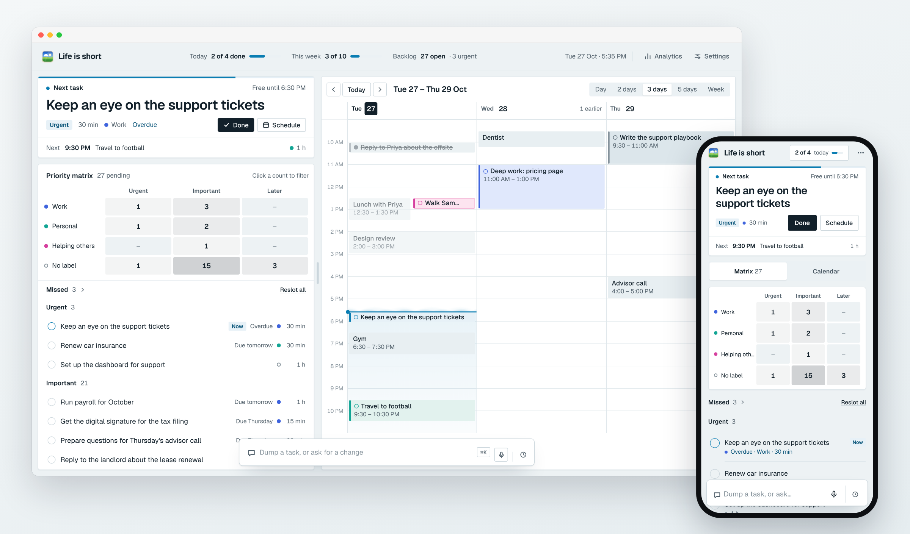
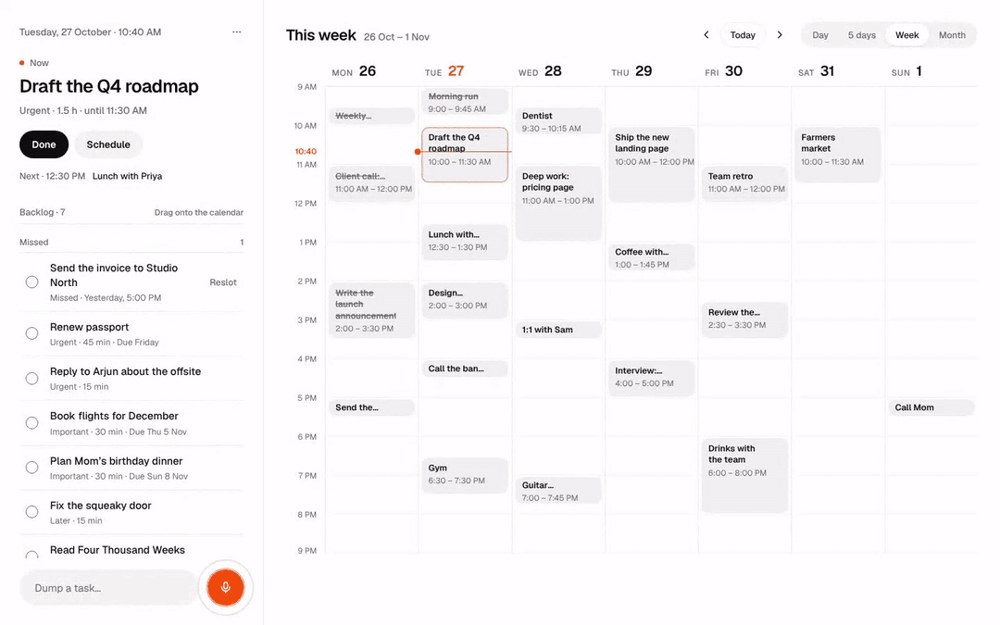
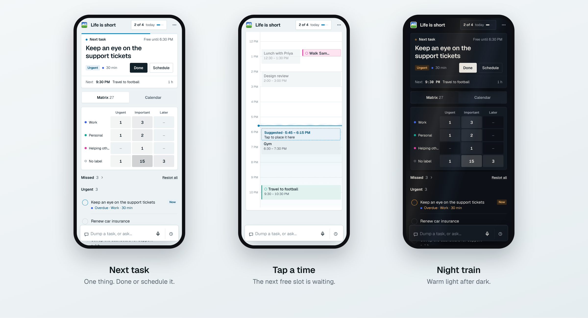
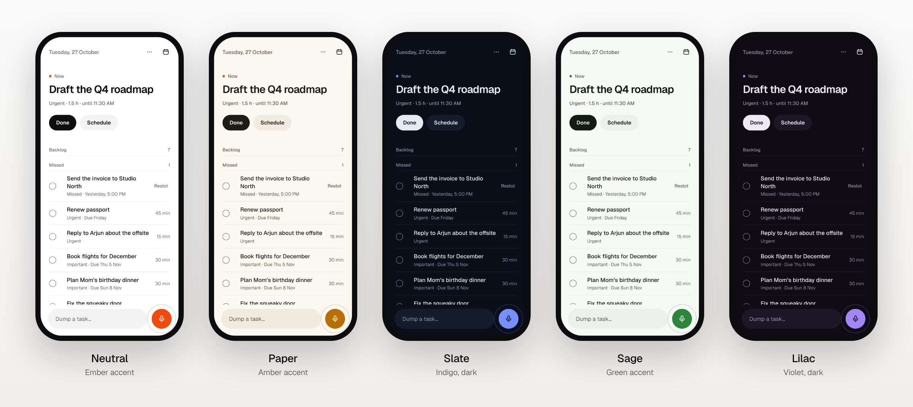
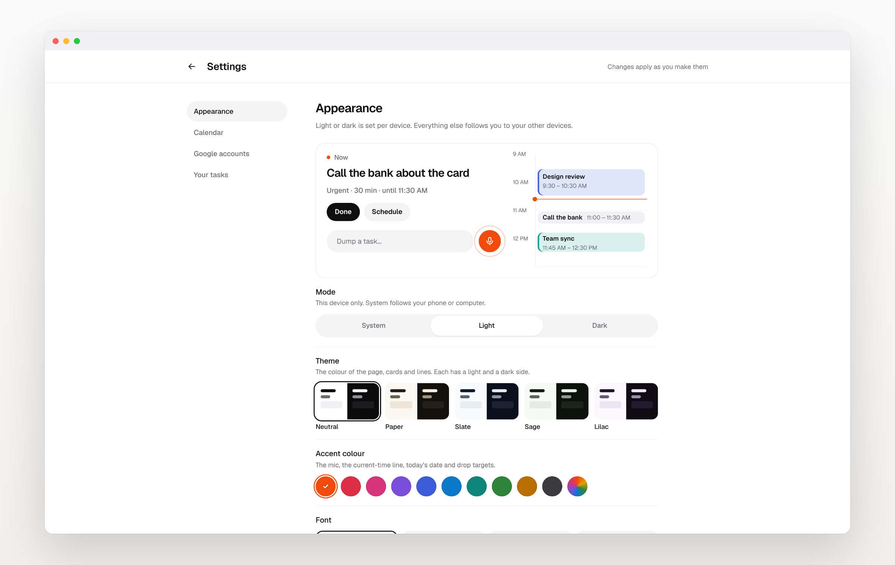

<div align="center">

# Life is short.

### Stop managing your to-do list. Do the one thing that matters right now.

Say what's on your mind. **Life is short** turns it into tasks, puts them on your calendar,<br>
and shows you the one thing to do **right now**.

[How it works](#how-it-works) · [Design](#designed-to-get-out-of-the-way) · [Make it yours](#make-it-yours) · [Sharing](#share-a-view-keep-the-keys) · [Security](#locked-down-by-default) · [Run your own](#run-your-own)

<br>

<picture>
  <source media="(prefers-color-scheme: dark)" srcset="docs/images/hero-dark.png">
  
</picture>

</div>

<br>

## The idea

You get about four thousand weeks. That's it. And most to-do apps want you to spend them *organising*: projects, tags, inboxes, contexts, reviews, a list that only gets longer.

**Life is short does the opposite.** One box to dump things into. One answer on the screen.

> **Dump it.** Type it or say it. A word, a list or a thirty-second ramble. You see the plan before anything changes.
>
> **Slot it.** A day or a time puts it on your calendar. Anything else lands in a backlog, already prioritised.
>
> **Do it.** The screen shows the one thing to do now, a **Done** button and a **Schedule** button. Nothing else to manage.

No folders. No filing: the AI even picks the label. No "weekly review". You don't keep a system going; you get on with your day.

<br>

## How it works

<p align="center">
  
</p>

<table>
<tr>
<td width="33%" valign="top">

### 1 · Dump

Type in the bar or tap the big mic and **just talk**. Your words stream in as you speak, and it keeps listening until you tap stop.

*"Finished the roadmap draft. Call the plumber tomorrow at 9, landing page copy is due Friday, and book a haircut at some point."*

The AI reads it like a good assistant would. It pulls out every task, gives each a short title, a priority and a realistic length, and works out dates. It also spots when you're talking about something **already on your list**: "finished the roadmap" ticks it off instead of adding a duplicate.

**Nothing lands until you say so.** When you stop talking you get the full transcript and the plan, one card per change: *new*, *move*, *tick off*. On a laptop the plan shows on the calendar too, dashed, right where it would go. Tap a card to edit it, cross one out, or just keep talking ("make the haircut Thursday afternoon") and the plan updates. **Accept** and it's done, with Undo; the chat clears for next time and lands in your history.

</td>
<td width="33%" valign="top">

### 2 · Slot

- **Said a day or a time?** It goes straight onto the calendar.
- **Said a deadline?** It waits in the backlog with a due date.
- **Said neither?** It waits in the backlog, ranked: **Urgent**, **Important**, **Later**, then by due date.
- **Every task gets a label**, like **Work**, **Personal** or **Helping others**. The AI picks it from what you said, or type a `#tag`.

When you're ready, one tap finds the **next free gap in your day**, on a 15-minute grid, inside the hours you set.

</td>
<td width="33%" valign="top">

### 3 · Do

The top of the screen is always **Now**: the task on your calendar at this minute, or the most important thing in your backlog.

**Done.** Or **Schedule**, which moves it to the next free slot. Below it you see what's **Next**.

Slipped past something? When its slot ends without a tick, it goes **back on top of your backlog**, ready for another go. No guilt, no lost tasks.

</td>
</tr>
</table>

Every capture, move and tick comes with **Undo**. A half-typed thought is still there when you come back. No AI key? A built-in parser understands "tomorrow at 9", "by Friday", "urgent", "2h" and "someday", so it keeps working.

<br>

## Designed to get out of the way

There are only two heavy things on any screen: **the task you're on, and the mic.** Everything else stays quiet.

You get the **window seat**. The task you're on sits on a painted view out of a train window: summer fields and big clouds, drifting slowly, the light breathing, a few birds crossing now and then. The rest of the planner sits on paper panels around it. Pick another view in Settings: golden hour, a night train, after the rain, a balloon, or above the clouds. Prefer a plain page? It's one switch.

<p align="center">
  
</p>

**On your phone** it's a focused list: Now on top, backlog below, the dump bar under your thumb. Tap the calendar for your day, then tap a task and tap a time to place it. The backlog groups by label and time (Today, This week, Next week and later), by time, or by priority.

**On your laptop** it opens up into a full planner: Now and the backlog on the left, a calendar on the right.

- **The backlog is a matrix:** a row per label, a column per priority. Drag a task to another cell to change its label or priority.
- **One split, sized your way.** Pick Day, 3 days (the default), 5 days or Week and the calendar widens to fit them. Or drag the divider: the calendar shows as many days as fit, and settles on the nearest. Or turn on **Auto layout** and your filters size it.
- **Views:** Everything, Work focus, Personal time and Just urgent are one tap away, or filter by priority and label and save your own. What you filter out fades on the calendar. Click a label to spotlight it.
- **Never hidden, just smaller:** when the calendar is wide, the matrix shrinks to titles, then to counts you can open (or folds the lowest priorities, if you prefer).
- **Drag** a task from the backlog onto any time. Drag it back to unschedule it.
- **Drag the edge** of a block to make it longer or shorter.
- **Click, then click.** Pick a task, then click a time slot.
- **Day, 3 days, 5 days, Week or Month**, with a live line for the current time.
- **Keyboard-friendly:** `E` edits, `Enter` opens a block, `Delete` sends it back to the backlog, `Esc` closes anything.

It feels fast because it is fast: rows ease in, ticked tasks get a satisfying check-and-strike, and your theme loads before the first frame, so it never flashes.

<br>

## Make it yours

<p align="center">
  
</p>

- **6 views** out of the window (Summer meadow, Golden hour, Night train, After the rain, Balloon, Above the clouds), or a plain page. Reduced motion holds the view still.
- **5 themes** (Paper, Neutral, Slate, Sage, Lilac), each with a light and a dark side, plus **true black** for OLED screens.
- **10 accent colours**, or pick your own. Life is short adjusts it until it's readable on your background.
- **9 fonts**, including **Lexend** and **Atkinson Hyperlegible** for easier reading.
- Text size, corner style, list density, **high contrast**, reduced motion, and a 12- or 24-hour clock.
- **Your day:** set the hours you work. The calendar shows them, auto-slotting stays inside them, and the AI plans around them.
- **Your labels:** the parts of your life, named, coloured and ordered your way. Every task wears its label's colour, so work time and personal time read at a glance.
- Week starts Monday, Sunday or Saturday. Shade weekends, show ISO week numbers, colour events by label, account, calendar or priority.

<p align="center">
  
</p>

Every change previews live and **follows you to your other devices**. Light or dark stays per device, so your phone can follow the sun while your laptop stays dark.

<br>

## Your whole life, one calendar

Connect **up to five Google accounts**, personal and work alike. Their **Google Calendar events and Google Tasks** land on the same calendar, each account in its own colour, so Life is short slots your tasks around the meetings you already have.

- It refreshes every 30 minutes while the app is open.
- A meeting that's on two of your accounts shows **once**.
- You choose which calendars to pull, per account. Holidays and other subscriptions stay off until you tick them.
- Give each account a **label** (or one calendar inside it, like a gym calendar on your work account) and its events take that label's colour.
- It's **read-only**: nothing is written back to Google. Your priorities, notes and done ticks stay yours.

<br>

## On every screen you own

Add a task on your phone in the queue for coffee and it's **on your laptop within seconds**. Live sync keeps every open screen up to date, and the phone and the laptop each get a layout built for them.

Want to try it without an account? Run it with no keys and it works **entirely in your browser**.

<br>

## Share a view, keep the keys

Let someone see your planner without handing it over. **Settings → Sharing**: add their email, pick what they see and for how long, and send them the link.

- **What they see is up to you:** the backlog, the calendar (today, upcoming or all), titles or just *busy*, with or without your Google events. Never your notes.
- **No account, no password:** they open the link and sign in with a code sent to that email. The link on its own isn't enough.
- **They can suggest, you decide:** a task for your backlog or a time on your calendar. A small badge tells you, and nothing lands until you approve it.
- **You always know your exposure:** who can see what, until when, which devices are signed in, and a log of every sign-in, view and wrong code. **See what they see** shows you exactly that, and **Stop sharing** signs them out on the spot.

<br>

## Locked down by default

Your task list is a map of your life, so it's protected like one.

- **PIN + authenticator code** to get in, once a day. After your first sign-in it never asks for your password again. There's no sign-up page and no email links to phish. People you share with never get an account: they get a view-only window, decided by the database.
- **The database checks it, not only the app.** Row-level security refuses to return a single task unless this session passed both checks in the last 24 hours. A stolen password, PIN or session token on its own reads nothing.
- **Five wrong PINs** and the PIN is wiped and every session is signed out.
- **A strict Content-Security-Policy**, HSTS, no framing and no caching of API responses.
- **A nightly backup** to a second database in another region. Before each copy it runs a set of breach checks, and if anything looks off it refuses to overwrite your last good copy. A weekly check confirms the two copies match exactly.

The full write-up is in [`docs/security.md`](docs/security.md).

<br>

## Run your own

Life is short is built to run as **your own private copy**: one person, your own database, nobody else's app.

```sh
npm install
npm run dev        # http://localhost:3000/app, with tasks stored in your browser
```

That's enough to try it. For your phone and laptop, add Supabase (sync and sign-in), a free Gemini key (AI sorting) and, if you like, Google:

- [**Setup guide**](docs/setup.md): local development, Supabase, Gemini, Google, Vercel and the full settings reference.
- [**Go-live checklist**](docs/go-live.md): every step from zero to running on your phone, in order.
- [**Security and backups**](docs/security.md): how sign-in, the database rules and the backup work.

Built with Next.js, TypeScript, Supabase and Gemini. Hosted on Vercel.

<br>

<div align="center">

### Life is short.
**Dump it. Slot it. Do it.**

</div>
