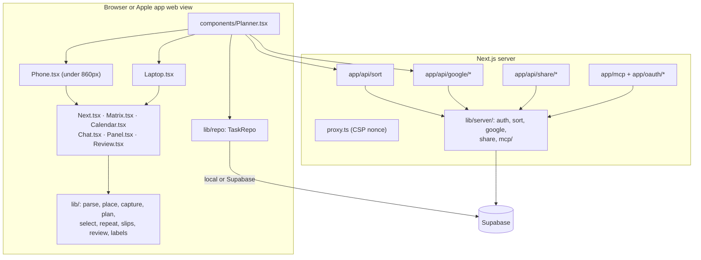
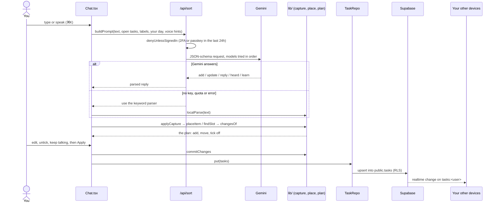

# Architecture

How Life is short is put together: the modules, how a dump becomes tasks, where data lives, and how the security rules are enforced. For setup see [`setup.md`](setup.md); for the security model in prose see [`security.md`](security.md); for the native apps see [`apple.md`](apple.md).

- [The big picture](#the-big-picture)
- [Modules](#modules)
- [A dump, end to end](#a-dump-end-to-end)
- [The Next task, slotting and missed slots](#the-next-task-slotting-and-missed-slots)
- [Data model](#data-model)
- [Sign-in and the database rules](#sign-in-and-the-database-rules)
- [Google, sharing and Claude](#google-sharing-and-claude)
- [The Apple apps](#the-apple-apps)
- [Backups](#backups)
- [Tests and CI](#tests-and-ci)

## The big picture

One Next.js (App Router) app does everything a server needs to: the public home page (`/`) and privacy page (`/privacy`), the planner (`/app`), a handful of API routes, the share viewer (`/shared`), and the MCP server for Claude (`/mcp` plus `/oauth/*`). It deploys to Vercel as-is.

The planner is a client-side React app. Its rules (what's the Next task, where a task fits, what a sentence means, how a week went) live in **pure functions under `lib/`** with unit tests beside them. Where tasks are kept is behind one interface, `TaskRepo` (`lib/repo/types.ts`), with two adapters:

| Adapter                | When                                           | Sync                                                                                              |
| ---------------------- | ---------------------------------------------- | ------------------------------------------------------------------------------------------------- |
| `lib/repo/local.ts`    | No Supabase keys (local-only mode)             | This browser only                                                                                 |
| `lib/repo/supabase.ts` | `NEXT_PUBLIC_SUPABASE_URL` and `_ANON_KEY` set | Postgres with row-level security; a realtime channel per user pushes changes to every open device |

## Modules

### `app/` (routes)

| Path                                       | What it is                                                                                                                      |
| ------------------------------------------ | ------------------------------------------------------------------------------------------------------------------------------- |
| `app/page.tsx`, `app/home.css`             | Public home page: what the app does, what it reads from Google and why. Required for Google's OAuth review.                     |
| `app/privacy/page.tsx`                     | Public privacy policy.                                                                                                          |
| `app/app/page.tsx`                         | The planner at `/app`.                                                                                                          |
| `app/shared/page.tsx`                      | The share viewer's page (`components/SharedPlanner.tsx`).                                                                       |
| `app/api/sort/route.ts`                    | Sends a prompt to Gemini with a JSON schema. A missing key or a failure tells the client to use the keyword parser.             |
| `app/api/google/*`                         | `auth-url`, `exchange`, `pull`, `disconnect`: OAuth and the read-only Calendar/Tasks pull, one call per account.                |
| `app/api/share/*`                          | `code`, `verify`, `view`, `suggest`, `sign-out`, `status`: the viewer's emailed-code sign-in, their view and their suggestions. |
| `app/mcp/route.ts`                         | The MCP endpoint (Streamable HTTP).                                                                                             |
| `app/oauth/*`                              | `authorize` (consent, behind the planner's sign-in), `approve`, `register` (RFC 7591), `token`, `revoke`.                       |
| `app/.well-known/*`                        | OAuth discovery (RFC 8414, RFC 9728) and `apple-app-site-association` for passkeys in the Apple apps.                           |
| `app/layout.tsx`, `app/manifest.ts`, icons | Metadata, install manifest and link-preview images.                                                                             |

### `components/` (UI)

- `Planner.tsx` owns state: tasks, settings, Google accounts, undo, the open panel. It picks `Phone.tsx` under 860px and `Laptop.tsx` above.
- Shared pieces: `Next.tsx` (the Next task card), `Matrix.tsx` (label × priority backlog), `Calendar.tsx`, `Chat.tsx` (chat bar, plan review and history), `Panel.tsx` (side panels and sheets for the editor, Analytics, Share and Settings), `Review.tsx` and `Analytics.tsx`.
- Settings sections: `AccountSection.tsx`, `GoogleSection.tsx`, `SharingSection.tsx`, `ClaudeSection.tsx`, `VoiceSection.tsx`, `Labels.tsx`, `Repeating.tsx`.
- `Split.tsx` (the laptop divider), `drag.ts` (pointer-event drag, so touch and mouse share code), `hooks.ts` (media queries, speech), `Ambient.tsx` (Night and Day train light, transforms and opacity only), `Auth.tsx` (sign-in and unlock), `Connect.tsx` (the Claude consent screen).

### `lib/` (pure logic, unit-tested)

| Module                                                         | Responsibility                                                                                                                                                                                                                                                             |
| -------------------------------------------------------------- | -------------------------------------------------------------------------------------------------------------------------------------------------------------------------------------------------------------------------------------------------------------------------- |
| `model.ts`                                                     | The `Task` shape (field names match an exported `tasks.json`, so import is a straight copy).                                                                                                                                                                               |
| `parse.ts`                                                     | `localParse`: the keyword parser used when there's no AI key or the AI fails ("tomorrow at 9", "by Friday", "urgent", "2h", "someday", `#tag`).                                                                                                                            |
| `prompt.ts`, `reply.ts`                                        | `buildPrompt` (open tasks, labels, your day, voice hints) and parsing the model's reply.                                                                                                                                                                                   |
| `capture.ts`, `place.ts`, `plan.ts`                            | `applyCapture` turns parsed items into task changes; `cleanItem`, `placeItem` and `findSlot` place them; `changesOf` and `commitChanges` turn an outcome into the reviewable plan and apply it.                                                                            |
| `select.ts`                                                    | Selectors: backlog order (`byBacklog`), missed and done lists, `focus` (the Next task), calendar layout, `visibleRange`, `progress`.                                                                                                                                       |
| `repeat.ts`, `slips.ts`                                        | Repeat rules and missed slots ("slips"), stored as settings so they sync.                                                                                                                                                                                                  |
| `review.ts`, `analytics.ts`                                    | The day/week/month review and the week in Analytics.                                                                                                                                                                                                                       |
| `labels.ts`, `layout.ts`, `calview.ts`, `prefs.ts`, `color.ts` | Labels, the laptop split, calendar views, settings, themes and accent contrast.                                                                                                                                                                                            |
| `speech.ts`, `voice.ts`                                        | Reading speech-recogniser output, and the voice profile that learns how you talk.                                                                                                                                                                                          |
| `google.ts`, `google-client.ts`                                | Mapping Google events and tasks, dedupe across accounts, merging into the planner.                                                                                                                                                                                         |
| `share.ts`, `share-client.ts`, `share-viewer.ts`               | Share settings and the viewer's side.                                                                                                                                                                                                                                      |
| `pin.ts`, `mfa.ts`, `passkey.ts`, `faceid.ts`                  | Unlock ways, TOTP, WebAuthn ceremonies through Supabase, Face ID after the PIN.                                                                                                                                                                                            |
| `native.ts`                                                    | The page's side of the Apple apps' bridge (`window.lisNative`). Does nothing in a browser.                                                                                                                                                                                 |
| `mcp/tools.ts`, `mcp/when.ts`                                  | What each MCP tool does, with the planner's own rules for repeats and missed slots.                                                                                                                                                                                        |
| `server/*`                                                     | Server-only: `auth.ts` (`denyUnlessSignedIn`), `sort.ts` (Gemini with model fallback and time limits), `google.ts` (OAuth, sealing refresh tokens with AES-GCM), `share.ts` (mail via Gmail SMTP or Resend), `mcp/` (OAuth, bearer check, database calls, the MCP server). |

## A dump, end to end

Nothing is written until **Apply**, and every apply, move and tick keeps an Undo. When the AI is unavailable the plan says it was sorted by the parser.

## The Next task, slotting and missed slots

- **Next task** (`focus` in `lib/select.ts`): the task on the calendar at this minute, otherwise the top of the backlog.
- **Backlog order** (`byBacklog`): priority (Urgent, Important, Later), then due date, then the task's own order.
- **Slotting** (`findSlot` in `lib/place.ts`): the next free gap on a 15-minute grid, inside the hours you set, around your Google events and the timed repeats to come.
- **Missed slots** (`lib/slips.ts`, `backToBacklog` in `lib/select.ts`): a slot that ends without a tick keeps the task on the calendar for an hour (`BACKLOG_GRACE`), then the task goes back on top of the backlog. The slot itself is remembered as a slip, so the review still counts it as missed where it happened.
- **Repeats** (`lib/repeat.ts`): a rule makes one ordinary task on each day it lands on; only one is open at a time.

## Data model

All in Supabase Postgres. Migrations are in [`supabase/migrations/`](../supabase/migrations) and run in order.

| Table                             | Purpose                                                                                                                                                                                                                                                                                                                                      |
| --------------------------------- | -------------------------------------------------------------------------------------------------------------------------------------------------------------------------------------------------------------------------------------------------------------------------------------------------------------------------------------------- |
| `public.tasks`                    | One row per task: `id`, `title`, `raw` (what you said), `notes`, `priority` (1–3), `minutes` (10–480), `start` (epoch ms; null = backlog), `due`, `status` (`open`/`done`), `created`, `sort_order`, `done_at`, `external_id` (`gcal:…`, `gtask:…`), `label` (0006), `updated_at`. Primary key `(user_id, id)`. In the realtime publication. |
| `public.settings`                 | Key–value JSON per user: `prefs` (look, calendar, labels…), `google` (accounts, with sealed refresh tokens), `repeats`, `slips`, `voice` and others.                                                                                                                                                                                         |
| `audit.sync_log`, `audit.snapshot()` | A row per backup sync (counts and a content hash), and one JSON summary of everything the breach checks look at, with emails and task content only hashed (0003). |
| `private.pins`, `private.unlocks` | PIN hash (bcrypt) and unlocks, for the 24-hour sign-in rule (0004).                                                                                                                                                                                                                                                                          |
| `private.face_ids`                | Face ID vouches for a device's session (0008).                                                                                                                                                                                                                                                                                               |
| `private.share_*`                 | Share key hash, shares, codes, viewer sessions, the activity log and suggestions (0005).                                                                                                                                                                                                                                                     |
| `private.mcp_*`                   | Connector key hash, one-time codes and grants with hashed access and refresh tokens (0009). A connection reads and writes tasks, goals, the charts' history (`goal-log`), repeats and slips, and reads prefs (0010, 0011).                                                                                                                                                                                                                                                  |

The theme, accent, ambient light and laptop split stay on each device (`localStorage`); everything else in `prefs` syncs.

## Sign-in and the database rules

- There's exactly one account. Sign-ups are off; the first sign-in on a device is email + password, then a TOTP code, then choosing a PIN.
- `0002_require_fresh_2fa.sql`, `0004_pin_unlock.sql`, `0007_passkeys.sql` and `0008_face_id.sql` add **restrictive** row-level security: a session sees rows only if it passed a code (or Face ID) in the last 24 hours **and** signed in with the password or unlocked with the PIN in the last 24 hours, or signed in with a passkey in the last 24 hours (`private.mfa_fresh`, `private.access_ok`).
- API routes call `denyUnlessSignedIn` (`lib/server/auth.ts`), which asks the database the same question, so a route never does work for a session the database would refuse.
- `proxy.ts` sets a nonce-based Content-Security-Policy per request; `next.config.ts` adds HSTS, `X-Frame-Options: DENY`, `Referrer-Policy: no-referrer`, a narrow `Permissions-Policy` (microphone only) and `Cache-Control: no-store` on `/api`, `/mcp` and `/oauth`.

## Google, sharing and Claude

- **Google** (`app/api/google/*`, `lib/server/google.ts`, `lib/google.ts`): `calendar.readonly` and `tasks.readonly` only. Refresh tokens are sealed with AES-GCM under a key derived from `GOOGLE_CLIENT_SECRET` before they're stored in your settings. The client pulls today through the next month every 30 minutes while open; `mergeExternal` and `dedupeItems` fold events into the planner, so a meeting on two accounts shows once.
- **Sharing** (`0005_sharing.sql`, `app/api/share/*`, `lib/server/share.ts`): viewers never get an account. The viewer functions in the database refuse any caller that doesn't present `SHARE_SERVER_KEY` (only its sha256 is stored). Codes and session tokens are stored as hashes; sessions live in an `HttpOnly`, `Secure`, `SameSite=Strict` cookie.
- **Claude** (`0009_connectors.sql`, `0010_goals.sql`, `0011_connector_goals.sql`, `lib/server/mcp/`, `lib/mcp/tools.ts`): OAuth 2.1 with PKCE (S256), dynamic client registration as a signed note, tokens bound to `/mcp`, refresh-token rotation with reuse detection. The connector functions need `MCP_SERVER_KEY` and a live access token. Ten tools: `list_tasks`, `get_task`, `create_task`, `update_task`, `complete_task`, `reopen_task`, `delete_task`, `list_goals`, `get_goal` and `change_goals`. `change_goals` takes the chart builder's operations (`lib/workflow.ts`, the same `applyWorkflow` the chart's bar uses), with the ids `get_goal` shows in place of the prompt's refs, and saves them in the app's order: goals, repeats, tasks, then the chart history. Moving a goal or a key result is checked first (`cantMoveGoal`, `cantMoveResult` in `lib/goals.ts`: no loops, the depth limits, no open goal under a closed one, at most 8 open top goals), so `normalizeGoals` never has to cut anything from a change.

## The Apple apps

`apple/` holds a UIKit app for iPhone and iPad and an AppKit app for the Mac, generated from `apple/project.yml` by XcodeGen. Both are thin shells around a `WKWebView` that loads `https://<your server>/app`. `apple/Shared/Resources/Bridge.js` puts `window.lisNative` on the page before its scripts run; `lib/native.ts` is the page's side, turning Siri, quick actions and Mac menu commands into planner commands. The pure Swift logic (addresses, navigation rules, deep links, colours, transcripts) is the `apple/Core` package, tested with `swift test`. Full detail: [`apple.md`](apple.md).

## Backups

`scripts/backup/run.mjs` has three modes:

- `sync` (daily, `.github/workflows/backup-sync.yml`): run the breach checks in `scripts/backup/checks.mjs`, then overwrite the backup's task rows through `backup_writer`, reading the primary through the read-only `backup_reader`. A blocking finding stops the overwrite.
- `verify` (weekly, `.github/workflows/backup-verify.yml`): the same checks on both databases, a fresh sync, a content hash comparison; fails on warnings too.
- `restore`: copy the backup's tasks into a primary you've made safe again (needs `CONFIRM=overwrite-primary`).

The job verifies Supabase's TLS certificate against the CA bundled in `scripts/backup/supabase-ca-2021.crt`, and prints only check names and counts, never emails, IPs or task text.

## Tests and CI

| Workflow                               | Runs                                                                                                                                        |
| -------------------------------------- | ------------------------------------------------------------------------------------------------------------------------------------------- |
| `ci.yml`                               | `npm ci --ignore-scripts`, `npm test` (Vitest), `npm run build` (which type-checks), on every PR and push to `main`                         |
| `apple.yml`                            | `swift test` for `apple/Core`; builds the iPhone/iPad and Mac apps; smoke-tests each against a local planner; signs release archives ad hoc |
| `apple-release.yml`                    | Archives and uploads both apps to TestFlight (manual, or on an `apple-v*` tag)                                                              |
| `backup-sync.yml`, `backup-verify.yml` | The backup jobs above                                                                                                                       |

Vitest picks up `lib/**/*.test.ts` and `scripts/**/*.test.mjs`. The SQL in the migrations is tested on PGlite (`scripts/db/pglite.mjs`, `sharing.test.mjs`, `connectors.test.mjs`), and the clock is pinned to `Asia/Kolkata` so date maths doesn't depend on the machine.
